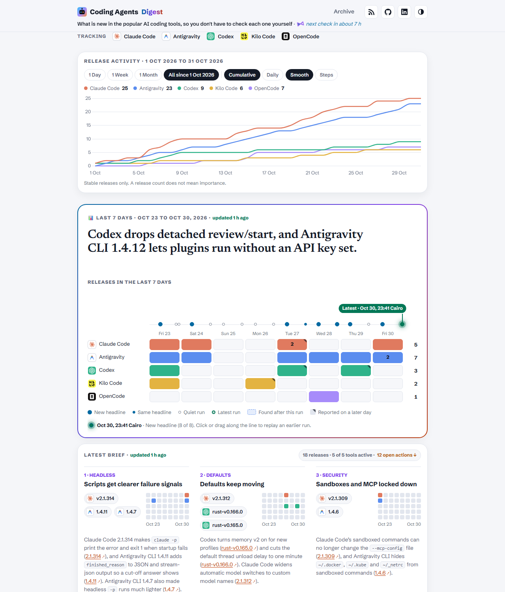
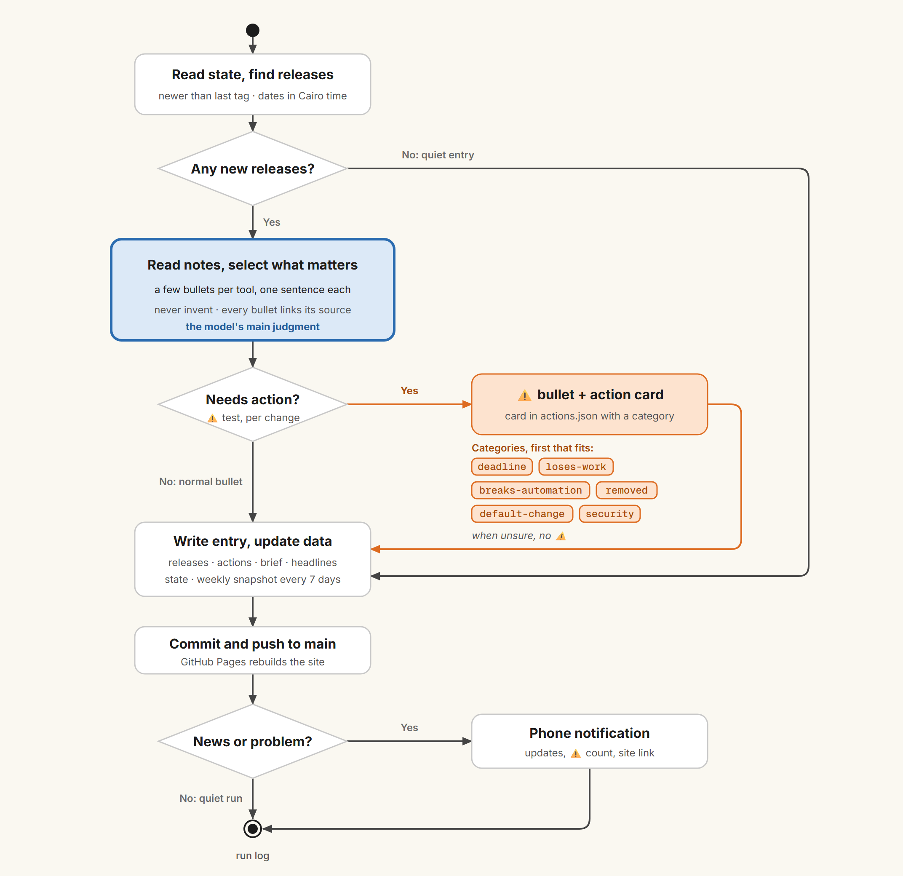

# Coding Agents Digest

What is new in the popular AI coding tools, so you don't have to check each one yourself.



Site: https://ibrahimsobh.github.io/coding-agents-digest/

RSS (Atom): https://ibrahimsobh.github.io/coding-agents-digest/feed.xml

Tracked: Claude Code, Antigravity CLI (`agy`), OpenAI Codex CLI, Kilo Code, OpenCode.
The site shows the short names Antigravity and Codex, with each tool's logo.

Not a list of changelogs: the changes that matter, one sentence each with a source link.

## What is on the home page

- **Tracking strip:** the five tools, under the header.
- **Release activity:** a chart of stable releases per tool, from 1 Day to all since 1 Oct 2026.
- **Last 30 days:** a moving window of one square per day for each tool, always ending on the
  day of the latest check. It does not follow the Release activity buttons or the replay line.
  Hover or focus shows the release and when a check reported it, and a click jumps to the update
  with a way back ("Back to the last 30 days"). A square from before the site's first update
  (Oct 22) has no update to jump to, and its tooltip says so.
- **Last 7 days:** the week's headline and the release grid (one row per tool, one column per
  day; a box sits on the day a release was published).
  - **Replay line:** click or drag along the line to see what each past check knew. The green
    point is the latest check, and "Jump to latest" appears when a past check is selected.
  - **Release boxes:** hover or focus shows each release and when a check reported it. A click
    jumps to the matching update in Daily updates, with a way back. A corner mark means the
    release was reported on a later day.
- **Latest brief:** 1 to 3 themes, each with a "so what". Each theme has release chips and a
  week map, the release grid in small with that theme's releases lit, so the week's pattern
  shows with no click. A chip jumps to the release's update. A release older than the 7 days
  gets a dashed chip with its date, and "+1 older" under the map.
- **Action board:** changes that need you to act (marked ⚠️), each with a category such as
  Deadline or Breaks automation.
- **Daily updates:** every check, newest first, quiet ones too, with a filter per tool.

Links to other sites open in a new tab, marked ↗ in the text. Links inside the site stay in the
same tab. The site has light and dark themes, and all times are Cairo time.

## How it works

A Claude scheduled task runs twice a day, at 08:30 and 23:30 Cairo local time
(Egypt). The times follow release hours: most releases land in two waves, about 20:00 to
02:00 and 06:00 to 10:00 Cairo time. The 23:30 run catches the evening wave on the same
day it ships, so a release and its entry usually share a date, and the 08:30 run catches
the night and early-morning releases.



The diagram follows `task/PROMPT.md`; its source is [`prompt-process.html`](prompt-process.html).
Each run:

1. Reads `task/state.json` (last run, last tag per tool, last snapshot date).
2. Checks the sources in `task/sources.yml` for newer stable releases.
3. Writes one entry `docs/digests/YYYY-MM-DD-HHMM.md`: a short news list, or "No updates since ...".
4. Appends new releases to `docs/_data/releases.json` (dated in Cairo time) and each ⚠️ item,
   with its category, to `docs/_data/actions.json`.
5. Rebuilds the 7-day brief `docs/_data/brief.json` and appends its headline to
   `docs/_data/headlines.json` (every run, quiet runs too).
6. If the last archived brief is 7+ days old, saves a snapshot in `docs/briefs/`.
7. Updates `task/state.json` and pushes to `main`.

GitHub Pages builds `docs/` with Jekyll. The chart, release grid, week maps, chips and action
board are computed by the site from the data files, not by the model.

Before it pushes, a run calls `task/check-links.sh`. It checks that links to other entries use
the full address and point to an entry that exists, and that every release link in the brief
is in `releases.json`. A pre-release may be named only with the word pre-release in its link
text, and it gets no chip.

## Files

| Path | Purpose |
|---|---|
| `task/PROMPT.md` | The scheduled task's instructions (source of truth) |
| `task/sources.yml` | Tools, Releases pages, tag patterns |
| `task/state.json` | Last run, last tag per tool, last snapshot date |
| `task/check-links.sh` | Checks entry links and the brief's release links |
| `docs/digests/` | One Markdown file per check |
| `docs/_data/brief.json` | The live 7-day brief |
| `docs/_data/actions.json` | Action board items, each with a `category` (set `dismissed: true` to hide one) |
| `docs/_data/categories.yml` | Labels for the action categories (rules are in `task/PROMPT.md`) |
| `docs/_data/releases.json` | Every covered release, Cairo dates (for the chart and the bars) |
| `docs/_data/headlines.json` | The brief's headline from every run (append only) |
| `docs/_data/tools.yml` | Tool names, short names, colors, GitHub repositories and logos |
| `docs/briefs/` | Weekly snapshots (archive, also in RSS) |
| `docs/_layouts/`, `docs/_includes/`, `docs/assets/style.css` | Site layout and style |
| `docs/_includes/history.html`, `docs/assets/history.js` | The release chart (drawn in the browser from `releases.json`) |
| `docs/_includes/brief.html` | The 7-day box, the release grid and the Latest brief |
| `docs/_includes/month.html` | The Last 30 days card |
| `docs/_includes/theme-map.html` | A theme's release chips and week map |
| `docs/assets/replay.js` | The replay line |
| `docs/assets/jump.js` | Release box tooltips, and the jump from a box or chip to its update |
| `docs/assets/logos/` | Tool logos (trademarks of their owners; the Codex logo is tinted to the site's Codex green) |
| `prompt-process.html` | Source of the run diagram (`docs/assets/prompt-process.png`) |

## Change the schedule

Edit the scheduled task's schedule. Each run covers everything since the
last digest, so the prompt does not change. Also update `RUNS` in
`docs/_layouts/default.html` (run times in Cairo minutes), which drives the header's
"next check in about N h".

## Preview locally

```
gem install jekyll kramdown-parser-gfm webrick
cd docs && jekyll serve
```
