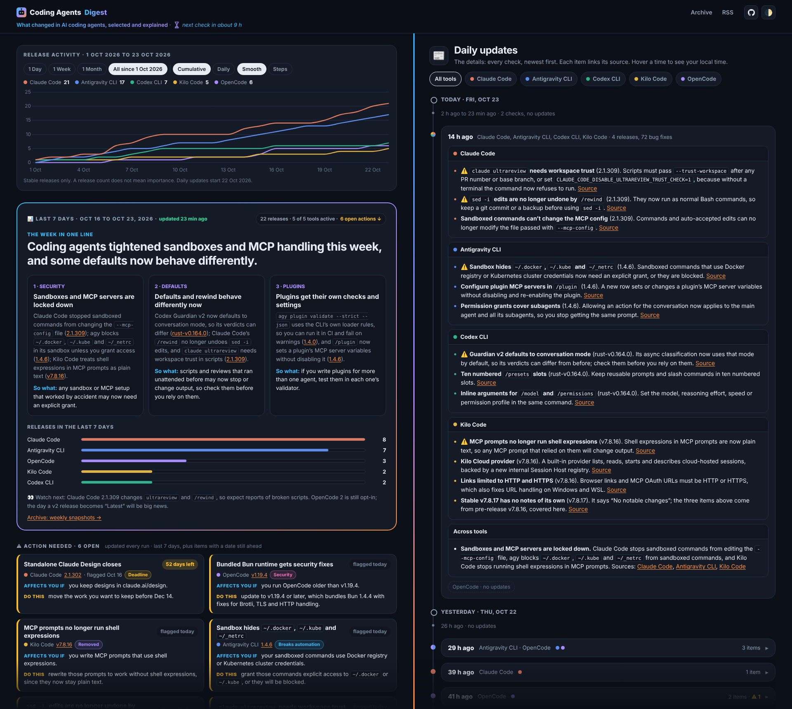

# Coding Agents Digest

A digest of what changed in AI coding agents, selected and explained.

<picture>
  <source media="(prefers-color-scheme: light)" srcset="docs/assets/screenshot-light.png">
  
</picture>

Site: https://ibrahimsobh.github.io/coding-agents-digest/

RSS (Atom): https://ibrahimsobh.github.io/coding-agents-digest/feed.xml

Tracked: Claude Code, Antigravity CLI (`agy`), OpenAI Codex CLI, Kilo Code, OpenCode.

Not a list of changelogs. The home page has a release chart (releases per tool since
1 Oct 2026), a 7-day brief (themes and release counts), an action board for changes that
need you to act (marked ⚠️, each with a category such as Deadline or Breaks automation),
and a daily timeline: the changes that matter, one sentence each with a source link.

## How it works

A Claude scheduled task runs twice a day, at 08:00 and 22:00 Cairo time
(`Africa/Cairo`, daylight saving included). The times follow US release hours: most
of these tools ship during the US workday, about 19:00 to 04:00 Cairo time. The 22:00
run catches the US morning releases, and the 08:00 run catches the rest of the US day.


The diagram follows `task/PROMPT.md`; its source is [`prompt-process.html`](prompt-process.html).
Each run:

1. Reads `task/state.json` (last run, last tag per tool, last snapshot date).
2. Checks the sources in `task/sources.yml` for newer stable releases.
3. Writes one entry `docs/digests/YYYY-MM-DD-HHMM.md`: a short news list, or "No updates since ...".
4. Appends new releases to `docs/_data/releases.json` (dated in Cairo time) and each ⚠️ item,
   with its category, to `docs/_data/actions.json`.
5. Rebuilds the 7-day brief `docs/_data/brief.json` and appends its headline to
   `docs/_data/headlines.json` (every run, quiet runs too).
6. If the last archived brief is 7+ days old, saves a snapshot in `docs/briefs/`.
7. Updates `task/state.json` and pushes to `main`.

GitHub Pages builds `docs/` with Jekyll. The home page shows the release chart, the 7-day
brief, the action board, and a daily timeline of all checks. The chart, release bars and
action board are computed by the site from the data files, not by the model.

## Files

| Path | Purpose |
|---|---|
| `task/PROMPT.md` | The scheduled task's instructions (source of truth) |
| `task/sources.yml` | Tools, Releases pages, tag patterns |
| `task/state.json` | Last run, last tag per tool, last snapshot date |
| `docs/digests/` | One Markdown file per check |
| `docs/_data/brief.json` | The live 7-day brief |
| `docs/_data/actions.json` | Action board items, each with a `category` (set `dismissed: true` to hide one) |
| `docs/_data/categories.yml` | Labels for the action categories (rules are in `task/PROMPT.md`) |
| `docs/_data/releases.json` | Every covered release, Cairo dates (for the chart and the bars) |
| `docs/_data/headlines.json` | The brief's headline from every run (append only) |
| `docs/_data/tools.yml` | Tool names and colors |
| `docs/briefs/` | Weekly snapshots (archive, also in RSS) |
| `docs/_layouts/`, `docs/_includes/`, `docs/assets/style.css` | Site layout and style |
| `docs/_includes/history.html`, `docs/assets/history.js` | The release chart (drawn in the browser from `releases.json`) |
| `DESIGN.md` | Design notes and decisions (not published) |
| `prompt-process.html` | Source of the run diagram (`docs/assets/prompt-process.png`) |

## Change the schedule

Edit the scheduled task's schedule. Each run covers everything since the
last digest, so the prompt does not change. Also update `RUNS` in
`docs/_layouts/default.html` (run times in Cairo minutes), which drives the header's
"next check in about N h".

## Preview locally

```
gem install jekyll kramdown-parser-gfm webrick
cd docs && jekyll serve
```
